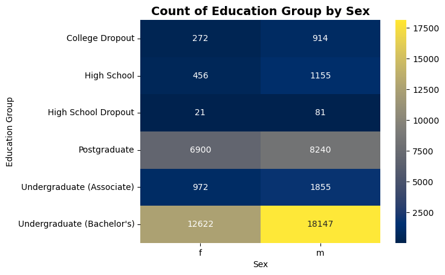
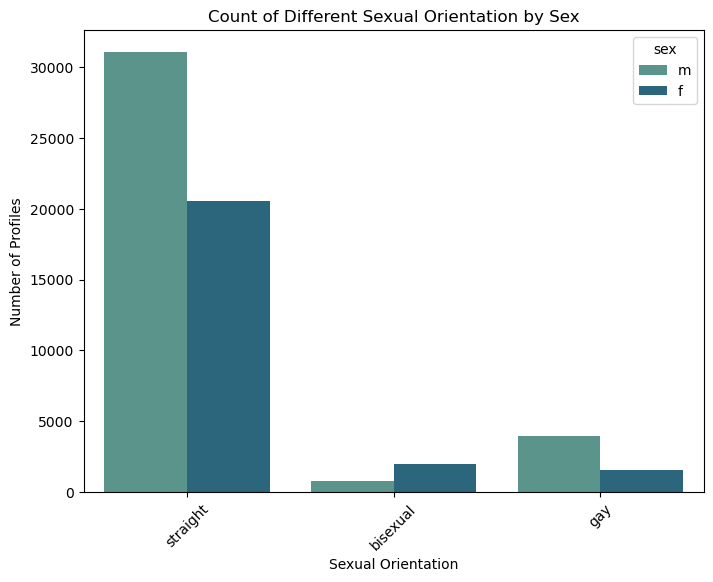
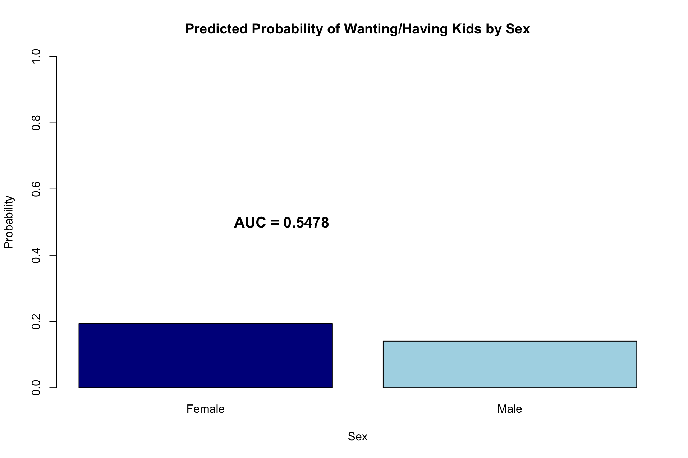
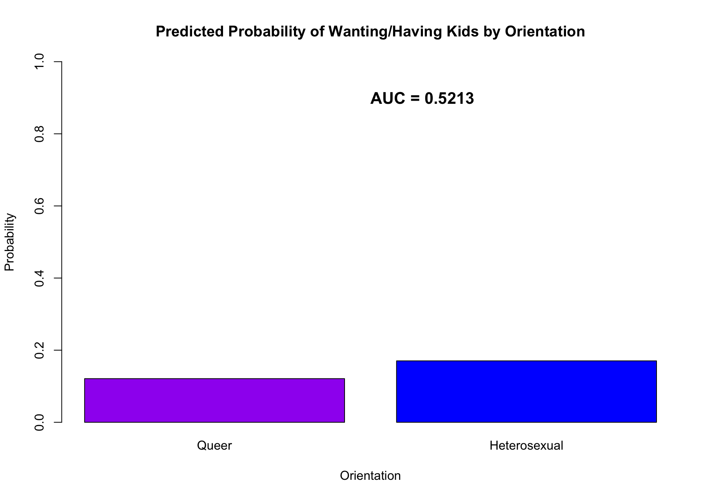

# Beyond Swiping Right: Statistical Analysis of 60K OkCupid Profiles

**Hypothesis testing, logistic regression and Isolation Forest anomaly detection on ~60,000 real dating profiles to study how identity relates to stated preferences, and whether profiles are internally consistent.**


---

## Research questions

1. **Is education level associated with sex among dating-app users?** → chi-square test of independence with Bonferroni-corrected follow-ups
2. **Does sex predict whether someone wants (or has) children?** → logistic regression (R)
3. **Does sexual orientation predict reproductive intentions?** → logistic regression (R)
4. **Do people mean what they say? Are some profiles internally inconsistent?** → Isolation Forest anomaly detection

## Key findings

- **Education and sex are strongly associated** (χ² = 466.2, p ≈ 1.6 × 10⁻⁹⁸). Follow-up goodness-of-fit tests at a Bonferroni-adjusted α = 0.05 / 6 ≈ 0.0083 identified **college dropouts** as a group where men and women differed significantly.
- **2,992 profiles (5%) have incoherent lifestyle answers.** An Isolation Forest trained on one-hot-encoded diet, drinking, smoking and drug-use answers flagged combinations that rarely occur together.
- **539 profiles look "too good to be true"**: a second Isolation Forest on education group × income band flagged unusual pairings, such as high-school dropouts reporting incomes of $250K.
- **Income distributions are similar for men and women** in the sample, suggesting users come from comparable socioeconomic backgrounds; the user base skews white, which limits generalizability.

## Methods

| Step | Tools |
|---|---|
| Cleaning: split multi-ethnicity answers, regroup 32 raw education labels into 8 levels, drop placeholder incomes (`-1`) | `pandas` |
| Exploratory analysis: ethnicity, body type, orientation, age, income and education by sex | `seaborn`, `matplotlib`, `statsmodels` mosaic plots |
| Hypothesis testing: chi-square test of independence + Bonferroni-corrected post-hoc tests | `SciPy` |
| Anomaly detection: Isolation Forest (contamination = 0.05) on encoded lifestyle and education/income features | `scikit-learn` |
| Prediction: logistic regression of reproductive intentions on sex and on orientation | R (`glm`) |

## Selected figures

| | |
|---|---|
|  |  |
|  |  |

A slide deck summarizing the project is included: `Beyond Swiping right – Analysis on okcupid.pptx`.

## Repository structure

```
├── main.ipynb                        # Python: EDA, chi-square tests, Isolation Forest
├── predict_sex_reprod_choice.rmd     # R: logistic regression models
├── logistical_regression.Rproj
├── profiles_revised 2.csv            # dataset (59,946 profiles)
├── *.png                             # exported figures
└── information_of_the_files.md
```

## Running it

```bash
pip install pandas numpy seaborn matplotlib scipy statsmodels scikit-learn jupyter
jupyter notebook main.ipynb
```

Update the CSV path in the notebook's second cell to `profiles_revised 2.csv` (it currently points to a local folder). Open `logistical_regression.Rproj` in RStudio and knit `predict_sex_reprod_choice.rmd` for the regression models.

## Data

OkCupid profiles from Kim & Escobedo-Land (2015), *Journal of Statistics Education*, via [rudeboybert/JSE_OkCupid](https://github.com/rudeboybert/JSE_OkCupid).

## Author

**Radiah Khan** · [Portfolio](https://radiah23.github.io) · [LinkedIn](https://www.linkedin.com/in/radiah-khan/)
